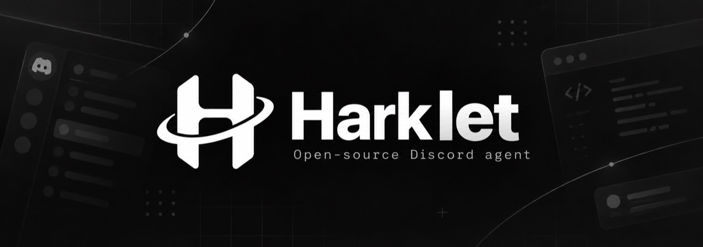

# harklet

会話とブラウザ作業の案内はユーザーの言語に合わせて応答します。`/language code:ja`・`/language code:en`・`/language code:ko` など、BCP47言語コードで応答言語を固定できます。`/language code:auto` で自動判定へ戻ります。固定ボタン・モーダル・Homeの見出し・操作結果は英語／日本語／中国語を翻訳済み。それ以外の言語では固定UIは英語です。コマンド説明はDiscordクライアントの言語に従います。ブラウザ操作への振り分けはモデルが判断し、日本語のログイン正規表現フォールバックは使いません。

普段のチャットでWeb作業を頼むと、Agentが必要に応じてユーザー専用のQuicksand Linux VM内でブラウザを操作します。Dockerは不要です。停止は`/stop`。導入方法と権限の範囲は[専用ブラウザの説明](docs/browser-agent.md)を参照してください。

作業開始時に閲覧専用noVNCのURLを本人のDMへ送ります。cloudflaredを導入するとスマホや別ネットワークからHTTPSで見られます。

**Languages:** [English](./README.md) | 日本語 | [中文](./README.zh.md)

Hark Pro に着想を得たパーソナル AI アシスタント Discord Bot。

**チャットからAgentに仕事を任せる体験**を中心に、記憶、Web操作、提案、プロアクティブな支援をDiscordに提供します。

## 機能

| Hark Pro | harklet での実装 |
| --- | --- |
| 記憶を持つチャット | chatチャンネル・DM・メンションでの会話 + ユーザーごとの長期記憶(SQLite)。重要な事実を自動抽出して保存 |
| Action Buttons | AI応答に実行ボタンが付く。「消して」「作って」と頼めばAgentがその場で実行(Homeカード・リマインダー・記憶・プロジェクト・地域・ブリーフ・モデル) |
| プロアクティブ支援 | リマインダーと毎朝のブリーフに加え、繰り返し作業の時期が来たらDMで提案。ブラウザ作業は依頼またはボタン操作で開始 |
| Specialties | チャットで繰り返す作業のやり方を教えられる。ブラウザ作業の完了時にAgentが再利用価値を判断して覚え、名前で再実行できる |
| Home | `/start` で設置される常駐ダッシュボード。今日の一手・天気・GitHub概要・予定・記憶をカード表示。30分ごと自動更新。カード管理はHomeへの返信やチャットで |
| Panels | HomeのカードはHark流のパネル。接続済みサービスの実データを取り込むカードや、ボタン付きカードをAgentが会話から作れる。Homeメッセージへの返信で会話編集も可能 |
| Projects | チャットやProjectsボタンから、話題別スレッドを作成 |
| Agentブラウザ | チャットでWeb作業を依頼すると、必要に応じて専用VMのブラウザを使い、進捗と結果を通知 |

外部サービスはユーザーごとにOAuthで接続できます。`/service connect` またはチャットで頼むだけ。**Google Workspace**（Gmail未読・カレンダー今日の予定）はループバックURL+コード入力、**Microsoft 365**（Outlook未読・予定）はデバイスコードフローでスマホから承認できます。リフレッシュトークンはブラウザログインと同じAES-256-GCM保管庫(`HARKLET_SECRET_KEY`)に入ります。接続後は会話でのデータ取得とHomeパネルへの表示が可能です。GitHubは引き続きVM内のWebサイトとして操作します（HomeのGitHub概要カードは別トークンの読み取り専用集計）。

「この手順を覚えて」「前の作業をもう一度」「覚えた作業を見せて」「この作業を忘れて」のように会話で管理できます。Specialtyは固定クリックを再生せず、保存した要点を参考に毎回画面を見直します。ブラウザから学んだ手順には入力値・認証コード・座標・URLのクエリを残しません。繰り返し間隔を指定した場合、朝のブリーフを有効にしたユーザーへ時期が来たらDMで提案します。提案だけで自動実行はしません。

テスト用の`/reset`は、`DISCORD_GUILD_ID`と`HARKLET_ENABLE_RESET=1`を設定して`npm run register`し、同じ設定でBotを起動したときだけ使えます。対象サーバーの管理者が実行すると、Harkletのカテゴリ・配下チャンネル・プロジェクトスレッドと、Harklet DB内の全ユーザーデータ（保存済みログイン情報を含む）を削除します。実行前に削除対象を表示し、確認ボタンを押す必要があります。ブラウザVMの保存済みCookieは削除しません。

## セットアップ

1. [Discord Developer Portal](https://discord.com/developers/applications) で Application を作成し、Bot トークンを取得。
   - Bot 設定で **Message Content Intent** を ON(パネル内の自由会話に必要)。
2. OAuth2 → URL Generator で `bot` + `applications.commands` を選択し、Bot Permissions は `Send Messages` `Create Public Threads` `Read Message History` を付けて招待。

   必要なBot権限（ビットフィールド `3197968`）:
   - チャンネルの閲覧、メッセージ送信、スレッドでのメッセージ送信、公開スレッド作成、メッセージ履歴の閲覧、**チャンネルの管理**(`/start` の自動作成用)

   招待URLテンプレート: `https://discord.com/oauth2/authorize?client_id=<CLIENT_ID>&permissions=3197968&scope=bot%20applications.commands`
3. リポジトリをセットアップ:

```bash
npm install
cp .env.example .env   # Windows: copy .env.example .env
# .env を編集: DISCORD_TOKEN / DISCORD_CLIENT_ID / OPENAI_API_KEY
# 任意: HARKLET_SECRET_KEY (Agentブラウザのログイン情報暗号化)
# 任意: GOOGLE_CLIENT_ID/SECRET, M365_CLIENT_ID (サービスコネクタ用 —
#   一度きりのOAuthクライアント作成は docs/oauth-setup.md 参照。src/connect/*.js に
#   既定値を埋め込めば利用者はログインするだけで使えます)
```

4. コマンド登録と起動:

```bash
npm run register   # コマンドをDiscordに登録(開発中は .env に DISCORD_GUILD_ID を入れると即時反映)
npm run doctor     # トークン・LLM・DBの疎通確認
npm start
```

## コマンド

最初に`/start`で作ったchatチャンネル、DM、またはメンションで普通に話しかけてください。Web作業、記憶、リマインダー、プロジェクト、ブリーフィングを会話から頼めます。非公開の依頼はDMで送ってください。

| コマンド | 説明 |
| --- | --- |
| `/start` | Harkletカテゴリとchat/home/projectsを設置。再実行時は既存チャンネルを再利用（要「サーバー管理」+Botに「チャンネル管理」） |
| `/model` | APIキーで利用可能なモデルを取得。検索・ページ送りで選び、Reasoning effortとともに「決定」で確定 |
| `/main set|off|show` | 既存チャンネルをメイン会話先に設定・解除・表示。`set`はチャンネルを作成しない |
| `/memory list|forget|clear` | 記憶の一覧・削除 |
| `/stop` | ブラウザ作業を止め、VMの状態を保存 |
| `/service list|connect|disconnect` | Google Workspace / Microsoft 365 のユーザー別OAuth接続を管理(チャットで頼んでも可) |

## LLM バックエンド

3系統のプロバイダをサポート。設定されたキーから自動判別します(`LLM_PROVIDER` で強制指定も可):

| Provider | キー環境変数 | API |
| --- | --- | --- |
| `openai` | `OPENAI_API_KEY` / `OPENROUTER_API_KEY` | OpenAI互換 `/chat/completions` — OpenAI / OpenRouter / LM Studio / Ollama / Gemini互換エンドポイント |
| `anthropic` | `ANTHROPIC_API_KEY` | ネイティブ `/v1/messages` |
| `google` | `GEMINI_API_KEY` / `GOOGLE_API_KEY` | ネイティブ `generateContent` |

`/model` でユーザーごとにモデルと Reasoning effort を切替可能。effort はプロバイダ別に変換: OpenRouter→`reasoning.effort`、OpenAI→`reasoning_effort`、Anthropic→`thinking.budget_tokens`、Gemini→`thinkingConfig.thinkingBudget`。

## 仕組み

- `src/index.js` — Discord イベント・コマンド・ボタン・スケジューラ
- `src/home.js` — Homeダッシュボード。LLM生成「今日の一手」+Open-Meteo天気+GitHub概要+リマインダー+記憶のEmbedカードを30分タイマーと更新ボタンで編集
- `src/dsh-agent.js` — 会話エンジン。DeepSeek Harness (DSH) のエージェントループをプロセス内に組み込み(cordis プラグイン → セッション → エージェントループ)、独自 `LlmAdapter` で OpenAI互換 / Anthropic / Google 各APIにブリッジ。構造化JSON `{reply, actions, remember}` をパース
- `src/llm.js` — プロバイダ別のモデル一覧自動取得
- `src/db.js` — `node:sqlite` による永続化(記憶・会話履歴・リマインダー・設定)
- `src/schedule.js` — 自然言語ふう時刻パーサ
- `src/computer/*` — Agentブラウザ基盤。Quicksand VM制御・視覚ループ・ログイン用モーダル・AES-256-GCMシークレット保管・認証付きnoVNCビューア(+任意でCloudflareトンネル)。VMは `sidecar/quicksand_session.py` が駆動
- `src/connect/*` — OAuthサービスコネクタ。Google Workspace(ループバックURL+モーダル)とMicrosoft 365(デバイスコード)。リフレッシュトークンは暗号化保管庫へ。チャット実行とHomeパネルのデータ注入の両方から使える
- `src/specialties.js` — 繰り返し作業(Specialty)のヒント。完了したブラウザ作業から安全な手順の要点を抽出し、Agentが再利用価値ありと判断したものを保存。再実行間隔の期限判定も担当

## 注意

- Message Content Intent を使うため、Bot が **1万ユニークユーザー** を超える場合は Discord の審査が必要です(2026/6 改訂)。それ未満なら Portal のトグルで動きます。
- 応答生成中はDiscord標準の「入力中…」タイピング表示を使います。
- Message Content Intent が未許可でも、DM と Botへのメンションは本文が届くため会話できます(チャンネル内の自由会話のみ不可)。
- AI の自動記憶抽出は誤爆しえます。`/memory list` / `forget` で管理してください。

## テスト

`npm test` でユニットテスト(秘密情報不要)。VM/integration テストは実際の Quicksand guest を起動するため opt-in です:

| テスト | 有効化 | 検証内容 |
| --- | --- | --- |
| `test/quicksand.integration.test.js` | `HARKLET_TEST_QUICKSAND=1` | VM起動・再起動後のcookie永続化 |
| `test/login-fill.integration.test.js` | `HARKLET_TEST_LOGIN_FILL=1` | VM内のフィールド検出+シークレット入力+送信で認証ページへ到達 |
| `test/login-handoff.integration.test.js` | `HARKLET_TEST_LOGIN_HANDOFF=1` + LLMキー | 実Discordログインページでvision agentが資格情報を要求 |
| `test/viewer-tunnel.integration.test.js` | `HARKLET_TEST_REMOTE_VIEWER=1` | Cloudflareトンネル経由で認証付きビューアをHTTPS配信 |

## License

MIT
